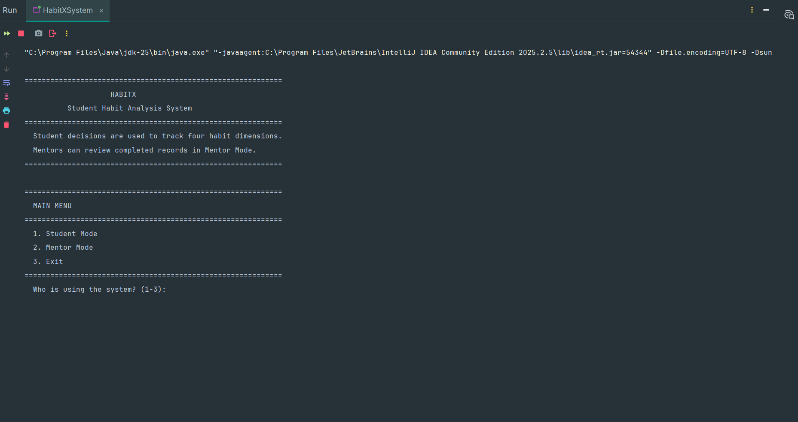
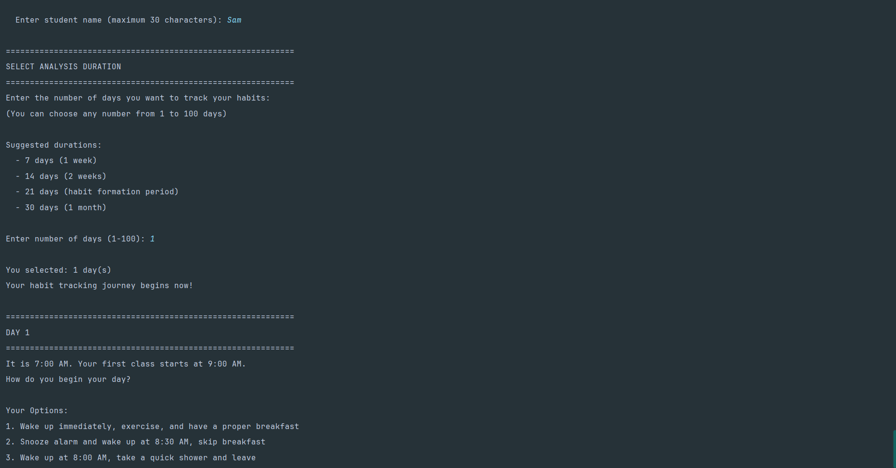
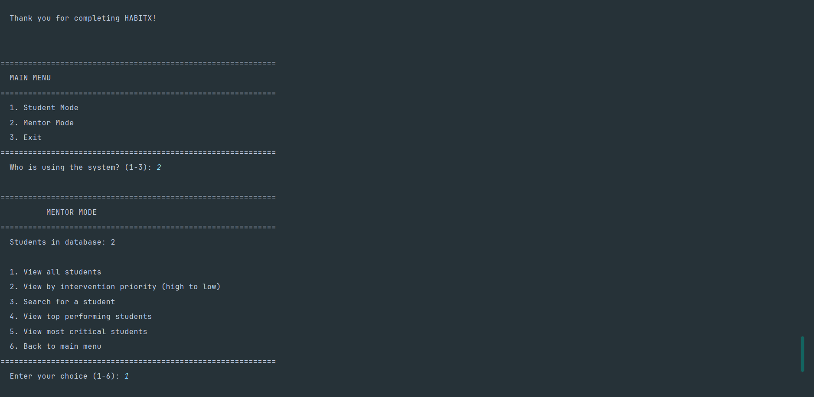
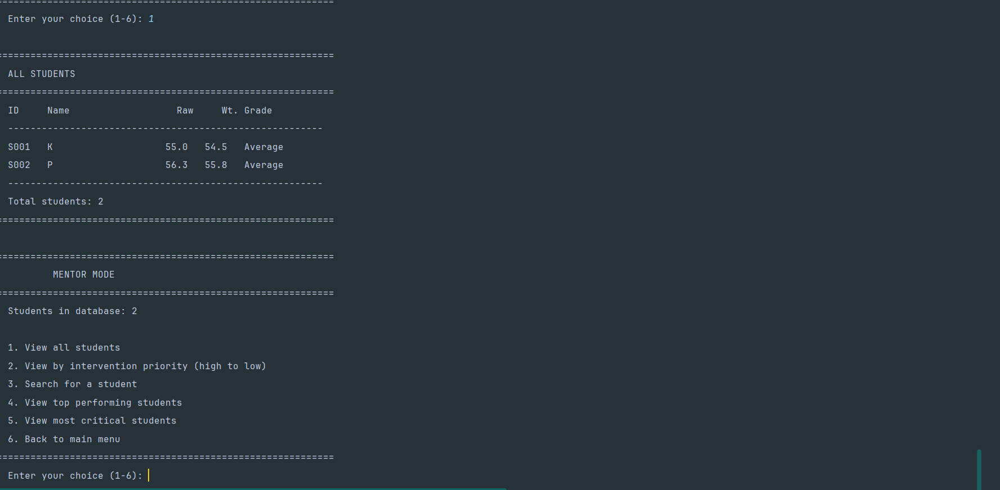

# HABITX – Student Habit Analysis System

A Java-based console application that tracks student habits, analyses performance and helps mentors identify students who may need additional support.

**Academic context:** Developed as a group project in Semester 1 at LJ University.

## Application Screenshots

### Main Menu


### Student Mode


### Mentor Dashboard


### Student Records


## Features

- Student habit tracking through decision-making scenarios.
- Four habit dimensions:
  - Study Discipline
  - Focus and Attention
  - Health and Energy
  - Time Management
- Weighted performance score calculation.
- Habit streak tracking.
- Student performance analysis and peer comparison.
- Mentor dashboard for viewing and searching student records.
- Intervention priority and performance rankings.
- Anonymous student identities in Student Mode.
- Actual student names available in Mentor Mode.
- Optional demonstration data.

## Technologies Used

- Java
- Object-Oriented Programming
- Arrays and Array of Objects
- Classes, Objects and Methods
- Constructors and Inheritance
- Selection Sorting
- Exception Handling

No external libraries or frameworks are required.

## Project Structure

```text
HABITX-Student-Habit-Tracker/
│
├── BaseHabit.java
├── FocusHabit.java
├── Habit.java
├── HabitXEngine.java
├── HabitXSystem.java
├── HealthHabit.java
├── MentorMenu.java
├── PeerComparison.java
├── Scenario.java
├── StudentDatabase.java
├── StudentRecord.java
├── StudyHabit.java
├── TimeManagementHabit.java
├── WeightedScoreCalculator.java
│
├── demos/
│   ├── main-menu.png
│   ├── student-mode.png
│   ├── mentor-mode.png
│   └── students-list.png
│
├── README.md
└── LICENSE
```

## How to Run

**Requirements:** Java JDK installed on your system.

1. Clone the repository:

```bash
git clone https://github.com/kushal9909/-HABITX-Student-Habit-Tracker.git
```

2. Open the project folder:

```bash
cd -HABITX-Student-Habit-Tracker
```

3. Compile the Java files:

```bash
javac *.java
```

4. Run the application:

```bash
java HabitXSystem
```

Optional demonstration data:

```bash
java HabitXSystem --demo-data
```

## Sample Output

An example of the mentor's student records:

```text
ALL STUDENTS

ID      Name       Raw     Wt. Grade
---------------------------------------
S001    K          55.0    54.5  Average
S002    P          56.3    55.8  Average

Total students: 2
```

*Sample values are illustrative demonstration records.*

## Privacy Design

HABITX separates the information displayed to students and mentors.

- **Student Mode:** Peer identities remain anonymous during comparisons.
- **Mentor Mode:** Mentors can view student names and their performance records.

## Limitations

- Data is stored in memory during the application session.
- Records are not retained after the application exits.
- The application supports a maximum of 100 student records.

## License

This project is licensed under the MIT License. See [LICENSE](LICENSE) for details.

---

**HABITX – Student Habit Analysis System**